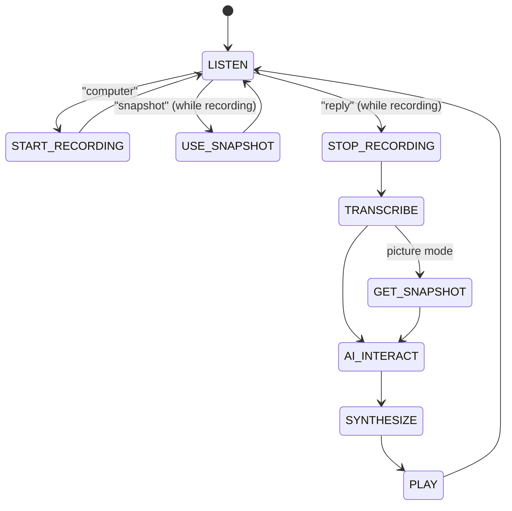

# Heddy

A hands-free voice assistant for a Linux box with a microphone, a speaker and
(optionally) a webcam. Say **"computer"**, ask your question, say **"reply"**,
and Heddy answers out loud. Say **"snapshot"** mid-question and it sends the
webcam picture along with your words, so you can ask "what is this?" while
holding something up to the camera.

Under the hood it chains four cloud services behind a small, testable state
machine:

| Stage | Provider |
| --- | --- |
| Keyword spotting (always on, on-device) | [PocketSphinx](https://github.com/cmusphinx/pocketsphinx) |
| Speech to text | [AssemblyAI](https://www.assemblyai.com/) |
| Reasoning, vision and tools | [OpenAI Responses API](https://platform.openai.com/docs/api-reference/responses) |
| Text to speech | [ElevenLabs](https://elevenlabs.io/) |

## How an interaction works

```
you:    "computer"                       -> start-recording chime, mic opens
you:    "what's the capital of Peru?"
you:    "reply"                          -> response chime, recording stops
heddy:  (transcribes, asks the model, synthesizes) "Lima is the capital of Peru."
you:    "computer, snapshot, what am I holding? reply"
heddy:  (webcam picture is attached to the question) "That looks like a Raspberry Pi 4."
```

Follow-up questions within 90 seconds continue the same conversation; after
that Heddy plays a soft chime and starts fresh. If a Zapier webhook is
configured, the model also gets a `send_text_message` tool, so "text Sam that
I'm running late" actually sends a message.

## Architecture

Everything flows through one loop in `heddy/controller.py`. Each stage of the
pipeline is an `ApplicationEvent`; a handler fills in its result (or an error)
and the controller maps the finished event onto the next one:



Any stage that fails (a dropped network connection, an API quota, a missing
camera) is logged and the loop returns to `LISTEN`, so a transient error never
takes the assistant down.

The controller only sees small interfaces (`Assistant`, `Transcriber`,
`Synthesizer`, `Player`, `Recorder`, `Camera`, `KeywordDetector`); the concrete
providers are wired together in `heddy/app.py`. That is what lets the whole
interaction flow be unit-tested without a microphone or an API key.

| Module | Responsibility |
| --- | --- |
| `heddy/controller.py` | The state machine: keyword rules, stage transitions, error recovery |
| `heddy/events.py` | `ApplicationEvent`, event types, `AssistantRequest` |
| `heddy/keyword_detector.py` | PocketSphinx endpointer + keyword search over a PyAudio stream, on a background thread |
| `heddy/audio/` | `AudioRecorder` (mic to WAV), `AudioPlayer` (sound effects and PCM speech), stderr silencing for ALSA |
| `heddy/speech_to_text/` | `STTManager` adapter and the AssemblyAI transcriber |
| `heddy/assistant/` | `AssistantManager` (Responses API, tool-call loop, image input), `Conversation` (context with inactivity timeout), `tools.py` (Zapier text message) |
| `heddy/text_to_speech/` | `TTSManager` adapter and the ElevenLabs synthesizer (raw PCM, no MP3 decoder needed) |
| `heddy/vision.py` | Webcam capture with `fswebcam`, started the moment "snapshot" is heard |
| `heddy/config.py` | `Settings` loaded from environment variables, validated up front |
| `heddy/resources/` | The keyword file and the sound effects |

## Requirements

- Linux with Python 3.10 or newer. (macOS mostly works too, except webcam capture, which relies on `fswebcam`.)
- A microphone and a speaker. PyAudio needs the PortAudio headers to build:

  ```bash
  sudo apt-get install portaudio19-dev        # Debian / Ubuntu / Raspberry Pi OS
  brew install portaudio                      # macOS
  ```

- Optional: a webcam plus `fswebcam` (`sudo apt-get install fswebcam`) for snapshots.
- API keys for OpenAI, AssemblyAI and ElevenLabs. Optionally a Zapier "Catch Hook" URL for text messages.

## Setup

```bash
git clone https://github.com/GravityPhone/heddy.git
cd heddy
python -m venv .venv && source .venv/bin/activate
pip install -e ".[dev]"

cp .env.example .env    # then fill in your keys
```

## Running

```bash
heddy                   # or: python -m heddy
heddy --env-file ~/secrets/heddy.env
```

Heddy greets you, plays the listening chime and waits for the wake word.
`Ctrl+C` stops it cleanly.

## Configuration

All settings come from environment variables (a `.env` file in the working
directory is loaded automatically). Only the three API keys are required.

| Variable | Default | Purpose |
| --- | --- | --- |
| `OPENAI_API_KEY` | required | OpenAI API key |
| `ASSEMBLYAI_API_KEY` | required | AssemblyAI API key |
| `ELEVENLABS_API_KEY` | required | ElevenLabs API key |
| `ZAPIER_WEBHOOK_URL` | unset | Enables the `send_text_message` tool; the model's message is posted as `{"text": "..."}` |
| `HEDDY_MODEL` | `gpt-4.1-mini` | Any model that supports the Responses API and image input |
| `HEDDY_INSTRUCTIONS` | built in | System prompt; the default asks for short, speakable answers |
| `HEDDY_MAX_OUTPUT_TOKENS` | `300` | Cap on the length of a reply |
| `HEDDY_CONVERSATION_TIMEOUT` | `90` | Seconds of silence after which the conversation context is dropped |
| `ELEVENLABS_VOICE_ID` | `21m00Tcm4TlvDq8ikWAM` (Rachel) | Voice to speak with |
| `ELEVENLABS_MODEL_ID` | `eleven_turbo_v2` | ElevenLabs model |
| `ELEVENLABS_OUTPUT_FORMAT` | `pcm_24000` | Must be a `pcm_<rate>` format so it can be played directly |
| `HEDDY_CAMERA_DEVICE` | `/dev/video0` | V4L2 device for snapshots |
| `HEDDY_LOG_LEVEL` | `INFO` | `DEBUG` shows every event transition |

The command words and their detection thresholds live in
`heddy/resources/keywords.kws`; lower thresholds make a word easier (and
falser) to trigger. To change what triggers a stage, edit that file and the
`WAKE_WORD`, `SNAPSHOT_WORD` and `REPLY_WORD` constants in the controller.

## Development

```bash
ruff check . && ruff format --check .   # lint and formatting
pytest                                  # unit tests, ~1 s, no hardware or keys needed
```

The tests drive the controller with fake components, exercise the OpenAI
wrapper against real SDK response objects and a fake client, and run the
recorder and player against a fake PyAudio. Keyword spotting is tested on real
speech synthesized with [`flite`](https://github.com/festvox/flite)
(`sudo apt-get install flite`); those cases skip when it is not installed.
The same checks run in GitHub Actions on Python 3.10 to 3.12.

## Known limitations

- Keyword detection and recording open two microphone streams at the same
  time, which works with PulseAudio and PipeWire but may not with bare ALSA.
- Every reply round-trips three cloud services, so expect a few seconds of
  latency between "reply" and the spoken answer.
- The keyword thresholds were tuned by ear for one voice and room; they may
  need adjusting for yours.
- Snapshots require `fswebcam`, which limits that feature to Linux.
